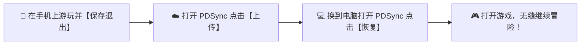

# PDSync · 像素地牢跨平台存档同步工具

  <b>让你的地牢冒险永不中断。随时随地，多端无缝接力。</b>

  <b>简体中文</b> | <a href="README.en.md">English</a>

  
  
  

---

**PDSync** 是一款专为《像素地牢》（Pixel Dungeon）及其衍生改版（如《破碎的像素地牢》Shattered Pixel Dungeon）打造的**跨平台存档多端同步工具**。

无论你是在通勤途中用 Android 手机下地牢，还是回到家在 PC 大屏前探索，PDSync 都能帮你轻松接力游戏进度，在多设备间自由切换。

> [!IMPORTANT]
> **💡 设计初心与游戏理念声明**：
> - 本工具的**唯一核心目标是实现多端设备间的进度同步与无缝续玩**，消除平台壁垒。
> - 《像素地牢》作为经典的 Roguelike 游戏，其不可逆的抉择与“永久死亡（Permadeath）”是其核心魅力与乐趣所在。
> - 系统内置的历史快照与版本回溯机制，初衷仅为**应对意外丢档、多端冲突裁决及网络异常时的容灾兜底**。我们**强烈不建议、也不鼓励将本工具用作反复读档刷关（S/L，Save & Load）的手段**，过度依赖回档会彻底抹杀 Roguelike 探索的随机性与紧张感，严重丧失游戏原本的成就感与乐趣。

---

## ✨ 核心特性

- 🔄 **跨平台多端无缝接力**：完整覆盖 Android、Windows、macOS、Linux，在手机与电脑之间自由接续同一份进度。
- ☁️ **灵活的双轨云存储方案**：
  - **内置 WebDAV（免配置开箱即用）**：免去繁琐的网盘参数配置，一键登录即用。支持通过赞赏开通，**赞赏款项仅用于维持后端服务器租用、带宽与存储的基本运营开支**。
  - **自建 / 第三方 WebDAV（完全免费自由）**：原生支持坚果云、Nextcloud、Alist、群晖及自建服务器等任意标准 WebDAV 服务，数据完全由你掌控。
- 🛡️ **健壮的防丢档与容灾保护**：
  - **恢复前本地自动备份**：写入云端存档前自动备份当前本地进度，杜绝误操作。
  - **清晰的冲突提醒机制**：当多台设备产生分支分歧时，弹出对比明确提示，由你决定保留哪份，绝不擅自覆盖。
  - **追加式快照记录**：清晰记录历次同步时间节点，遇到异常状态随时可核对与追溯。
- 📱 **Android 双接入方案**：
  - **免 Root 模式（内置存档桥）**：无需设备 Root，通过内置向导为游戏 APK 打包存档桥即可接入。
  - **Root 模式**：已 Root 设备直接授权读取，无需重新签名与二次安装。
  - **改版独立隔离**：自动识别不同改版，存档独立维护，互不串档。
- 💻 **桌面端开箱即用**：打包内置 Java 运行时环境（无需额外配置 JDK），四步向导轻松起步。

---

## 🎮 支持的游戏与平台

| 平台 | 支持的游戏 / 改版 | 说明 |
| :--- | :--- | :--- |
| **Android** (8.0+) | 《破碎的像素地牢》及主流兼容改版 | 提供 **免 Root 存档桥模式** 与 **Root 模式**。不同改版存档独立隔离。 |
| **桌面端** (Win / Mac / Linux) | 《破碎的像素地牢》(Shattered Pixel Dungeon) | 接入官方可执行游戏 JAR（如 3.3.8、4.0.2 及后续兼容版本）。 |

> [!WARNING]
> **⚠️ Android 免 Root 模式重要须知（安装前必读）**：
> 免 Root 方案通过在游戏安装包中集成存档通信桥并**使用新证书重新签名**。由于 Android 系统严格的代码签名校验机制，重新签名后的安装包**无法直接覆盖原版安装，必须先卸载系统内原有的原版游戏**。
> 
> **请特别注意：卸载原版游戏会导致系统同时清空该游戏现存的所有本地数据与存档！**
> - **建议操作**：请务必在打完当前这一局（通关或阵亡结算）后再进行卸载与重装配置。
> - 如果你的设备已拥有 Root 权限，强烈推荐直接选用 **Root 模式**，可原生读取现有数据，**无需卸载、完全保留原有进度**。

> [!NOTE]
> **存档格式提示**：PDSync 负责进度传输与备份，但**不转换存档底层格式**。跨设备同步应在相同或相近版本的同一改版之间进行。

---

## 📦 下载与安装

请前往 [Releases 页面](https://github.com/xyz1001/pixel-dungeon-sync/releases)（或在 CI 构建产物/测试发布包中）下载对应平台的安装包：

| 系统平台 | 推荐下载文件 | 安装 / 运行方式 |
| :--- | :--- | :--- |
| **Windows** (x64) | `PDSync-Setup.exe` 或 便携版 `.zip` | 安装版直接运行向导；便携版解压后双击主程序即可（内置 Java，无需另配环境）。 |
| **Android** (8.0+) | `PDSync-*-android.apk` | 手机直接安装 APK（已集成完整签名，无需额外配置运行库）。 |
| **macOS** (Apple Silicon) | `PDSync-*.dmg` | 打开 DMG 镜像后拖动图标至“应用程序”文件夹。 |
| **Debian / Ubuntu** | `pdsync_*_amd64.deb` | 执行 `sudo apt install ./pdsync_xxx.deb` |
| **Arch Linux** | `pdsync-*.pkg.tar.zst` | 执行 `sudo pacman -U ./pdsync-xxx.pkg.tar.zst` |

> [!TIP]
> **关于安全拦截提示**：
> 桌面版若在 Windows (SmartScreen) 或 macOS 遇到“未知开发者”提示，属于开源项目未购商业签名证书的正常现象，选择“仍要运行”或在系统安全设置中允许即可。

---

## 🚀 3分钟快速上手

无论在手机还是电脑上，初次使用只需简单三步：

### 第一步：准备云存储（二选一）

PDSync 提供两种云存储连接方式，任选一种即可：

#### 选项 A：使用内置 WebDAV（免配置，省心推荐）
- **特点**：无需折腾自建服务，也无需申请第三方网盘应用密码，在应用内登录内置账号即可直接连通。
- **关于赞赏说明**：内置服务支持通过赞赏开通。**赞赏金额仅用于维持云端服务器租赁、公网流量与存储的基本硬件与运营成本**，无商业盈利目的，感谢大家的理解与支持！

#### 选项 B：使用自己的 WebDAV 服务（完全免费自主）
- **特点**：支持坚果云、Nextcloud、Alist、自建 WebDAV 等任意标准服务，完全免费且数据完全由你自主掌控。
- **配置示例（以坚果云为例）**：
  1. 登录坚果云网页版，进入【账户信息】->【安全选项】->【第三方应用管理】。
  2. 点击“添加应用”（如命名为 `PDSync`），生成独立授权密码。
  3. 在 PDSync 中填入连接参数：
     - **服务器地址 (URL)**：`https://dav.jianguoyun.com/dav/`
     - **账户名**：你的坚果云注册邮箱
     - **应用密码**：刚生成的独立应用密码

---

### 第二步：配置同步器

#### 📱 Android 端配置：
1. 打开 PDSync，在游戏列表中选择你要同步的像素地牢或改版。
2. **选择存档读取模式**：
   - **免 Root 模式（推荐普通设备）**：按向导选择游戏原版 APK 进行准备与签名。**（提示：需要先卸载手机上的旧版游戏，原版现有进度会被清除，请在当局结束后再操作）**。
   - **Root 模式（推荐已 Root 设备）**：直接授权 Root 权限即可原地读取，**完全无需卸载原游戏**。
3. 连接云端：直接登录内置账号，或填入自己的 WebDAV 地址及账号密码，点击【测试连接】，通过后即可开始同步。

#### 💻 桌面端配置：
1. 打开 PDSync，四步引导会帮你自动扫描或手动选择游戏 JAR 文件及存档路径。
2. 登录内置账号或填入自定义 WebDAV 连接信息，测试通过后保存。
3. 比对两端内容，根据当前设备情况选择【上传】现有进度或从云端【恢复】。

---

### 第三步：日常同步与游玩流程

日常游玩只需记住简单的“一存一取”工作流：

- **离开游戏时**：在游戏内点击“保存并退出”，回到 PDSync 点击【上传当前存档】（若开启了自动同步，退出游戏后会自动为你上传）。
- **换设备游玩时**：先在另一台设备上打开 PDSync，点击【恢复到本机】，完成后再启动游戏，即可接着玩！

---

## 🛡️ 容灾保护与进阶机制

### 1. 冲突保护与覆盖确认
- 如果你在两台设备上都推进了进度但未及时同步，PDSync 在比较时会明确标出冲突。
- 软件会弹出清晰的对比弹窗，由你决定是以当前设备的存档作为最新基准，还是取消操作先做核对，**绝不擅自冲掉任何数据**。

### 2. 本地自动安全备份
- 在执行任何云端写回本地的恢复操作前，PDSync 都会先在本地将当前存档打一个独立备份，即使误点恢复也有据可查。

### 3. 自动同步感知
- 桌面端与部分环境支持后台感知游戏退出与存档文件变化，支持空闲自动上传（可在设置中随时一键暂停该功能）。

---

## ❓ 常见问题 (FAQ)

<b>Q1: 内置 WebDAV 和自建 WebDAV 有什么区别？赞赏是强制的吗？</b>

<b>赞赏完全自愿，绝非强制！</b> 
PDSync 对自定义 WebDAV（如坚果云、自建网盘等）提供完整、永久免费的支持。 
内置 WebDAV 是为了方便不想折腾网络配置的玩家而搭建的“开箱即用”服务。由于云服务器带宽与数据存储有持续的硬件租赁成本，我们通过赞赏机制来维持服务器收支平衡，所得款项仅用于服务器运维支出。

<b>Q2: 为什么 Android 免 Root 模式必须卸载原版游戏？本地进度会丢吗？</b>

<b>会丢失！</b>因为 Android 系统的安全机制要求覆盖安装的应用必须使用完全相同的签名证书。免 Root 方案必须给 APK 注入存档通信桥并重新签名，这导致签名与原版不一致，无法直接覆盖，必须先卸载原版。 
<b>卸载会导致系统自动删除原版游戏内部的存档。</b>请务必打完当前局或确认不再需要旧进度后再卸载重装。如果手机有 Root 权限，使用 Root 模式则完全不会有这个问题。

<b>Q3: 这个工具能用来搞 SL（读档重来）吗？</b>

PDSync 的设计目标是<b>跨设备存档接力</b>与<b>意外容灾</b>。虽然技术上存在历史快照，但我们<b>非常不提倡将其作为 SL 手段</b>。《像素地牢》的精髓正是随机性与死亡惩罚，频繁 SL 会让通关索然无味，失去游戏的原本乐趣。

<b>Q4: 点击“恢复”会把本机现有的存档冲掉吗？</b>

在恢复写入前，PDSync 会先对本地当前存档做一个独立备份。但为避免混淆，建议换设备前先确认另一端已点击上传。

<b>Q5: 上传按钮为什么显示灰色不可点击？</b>

常见原因有两个：
1. 本地当前存档内容与云端最新记录完全一致（无需重复上传相同内容）。
2. 尚未启动过游戏，本地尚无任何存档文件（请先进游戏走动两步并正常保存退出）。

<b>Q6: 恢复完成后启动游戏，怎么还是原来的老进度？</b>

请确保在点击“恢复”前已经<b>彻底退出/关闭了游戏进程</b>。如果游戏一直在后台常驻，其内存中的旧进度会在退出时再次写回磁盘，导致刚恢复的文件被覆盖。

<b>Q7: 便携版 (Portable) 的配置保存在哪里？</b>

为了避免覆盖更新时丢失配置，桌面端所有配置及运行记录默认保存在当前操作系统的用户目录下（`~/.pixel-dungeon-sync`）。更换便携版程序无需重新设置。

<b>Q8: 出现网络报错或连接超时怎么排查？</b>

1. 检查 WebDAV 地址是否完整（例如坚果云末尾需要带 `/dav/`）。
2. 检查是否开启了代理软件干扰局域网或 WebDAV 流量。
3. 可在【设置】->【诊断日志】中查看详细原因或导出排查报告。

---

## 🤝 反馈与参与贡献

如果你在游玩与同步过程中遇到任何疑问或发现 BUG，欢迎通过以下方式交流与反馈：

- 提交问题报告：[GitHub Issues](https://github.com/xyz1001/pixel-dungeon-sync/issues)
  *(反馈时建议附带系统版本、游戏改版名称、具体复现步骤以及设置中的脱敏诊断信息)*
- 开发者与构建说明：参阅 [RELEASING.md](docs/RELEASING.md) 与 [代码开发文档](docs/)

---

  祝各位在地牢中探险愉快，Amulet of Yendor 唾手可得！🧙‍♂️🗡️

